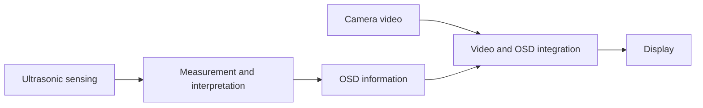

# Ultrasonic Parking Assistance System with Video OSD

An embedded systems project combining ultrasonic obstacle sensing with a video on-screen display (OSD) for parking assistance.

**Project author:** [Andre Gomes](https://github.com/AndreGomesGIT)  
**Repository:** `AndreGomesGIT/ultrasonic-parking-assistance-osd`

## Overview

The project brings together ultrasonic sensing and video display integration to present obstacle information within a parking camera view. This repository provides a public engineering overview while protecting the implementation details of the underlying product.

The documentation focuses on the engineering considerations involved in connecting physical measurements to useful visual feedback: echo interpretation, measurement timing, hardware and firmware integration, and display behavior.

## Functional architecture

The following diagram describes the system at a conceptual level. It does not specify the circuit topology, component selection, or production implementation.

## Engineering topics

- Ultrasonic echo acquisition and interpretation.
- Timing coordination between sensing and visual updates.
- Integration of sensing hardware, embedded firmware, and video OSD.
- Investigation of measurement limitations and interference.
- Bench validation and clear communication of system behavior.

These topics define the scope of the engineering discussion. Specific components, algorithms, tools, and measured performance are documented only when supported by project records.

## Documentation

| File | Contents |
| --- | --- |
| [DEVELOPMENT.md](DEVELOPMENT.md) | Engineering considerations, documentation boundaries, and implementation details awaiting confirmation. |
| [TESTING.md](TESTING.md) | Proposed validation procedure, evidence requirements, and test record format. |

## Documentation status

This initial portfolio edition describes the project at a functional level. Hardware identifiers, firmware language, individual development responsibilities, production history, and numerical performance results remain to be confirmed from the author's records.

The testing document is a proposed validation framework; it does not report completed tests or verified performance. Photos, video demonstrations, and measurement captures can be added when available and approved for public release.

## Repository scope

This is a documentation repository. Production firmware, detailed schematics, PCB layouts, manufacturing files, component values, and proprietary signal-processing details are not included. The available material is insufficient to reproduce the product.

No open-source license for the underlying hardware or firmware is granted by this repository.

## Contact

For professional inquiries, visit [Andre Gomes on GitHub](https://github.com/AndreGomesGIT).
