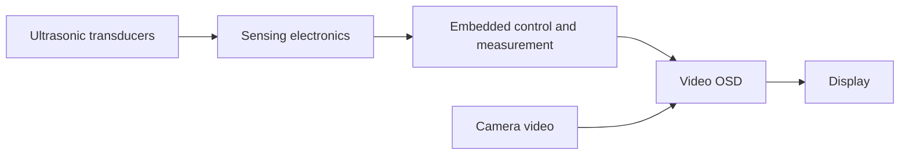

# Ultrasonic Parking Assistance System with Video OSD

An embedded parking assistance project that combines ultrasonic sensing with on-screen information over a camera image.

**Author:** [Andre Gomes](https://github.com/AndreGomesGIT)  
**Repository:** `AndreGomesGIT/ultrasonic-parking-assistance-osd`

## Project overview

This project connects ultrasonic obstacle sensing to a video on-screen display (OSD), allowing proximity information to appear within the same view as the camera image.

The available project records include assembled hardware, PCB design revisions, 3D board views, circuit simulations, oscilloscope measurements, and a recorded display demonstration. This public portfolio presents the system's observable behavior and engineering scope while keeping the detailed implementation private.

## Demonstrated display behavior

Selected frames from the recorded demonstration show:

- A numerical reading accompanied by a bar-style proximity indicator.
- A `PARE` warning, Portuguese for `STOP`.
- A `---` display state in place of the numerical reading.
- These display elements appearing over a camera image.

The recording also contains colored parking guide lines. Their source is not established by the reviewed material, so they are not attributed to this project's OSD implementation.

The footage demonstrates display states; it does not establish measurement accuracy, detection range, response time, or the conditions that trigger each state.

| Numerical display | Stop warning |
| --- | --- |
|  |  |

[Open the demonstration recording](videos/demo.mp4). GitHub may offer the recording as a download rather than an inline player.

## Functional architecture

This is a functional overview. It omits circuit topology, component values, signal assignments, and firmware implementation.

## Engineering scope

- Integration of ultrasonic sensing electronics and embedded control.
- Coordination of measurement information and video overlay updates.
- PCB development and physical integration.
- Simulation and bench waveform investigation.
- Visual presentation of proximity information and warning states.

The design archive includes schematic title blocks bearing the author's name. Firmware language, individual responsibilities across all revisions, commercial deployment history, and production quantities are not established by the reviewed records.

## Hardware

The private archive contains assembled board photographs and multiple design views. The enclosure photograph is included here to show the physical unit without publishing detailed board routing or schematics.

## Documentation

| Document | Contents |
| --- | --- |
| [Development notes](DEVELOPMENT.md) | Hardware development evidence, sensing considerations, video integration, and documentation boundaries. |
| [Testing and validation](TESTING.md) | Review of existing evidence and a proposed procedure for quantitative validation. |

## Public repository scope

This repository contains a portfolio case study and selected media. Production firmware, complete schematics, PCB routing, manufacturing files, raw measurement binaries, and proprietary processing parameters are excluded.

The source archive contains material from different revisions and reference documents for multiple components. A reference datasheet is not treated as proof that its component was used in the assembled system.

No license to the underlying hardware or firmware is granted by this documentation.

## Contact

For professional inquiries, visit [Andre Gomes on GitHub](https://github.com/AndreGomesGIT).
